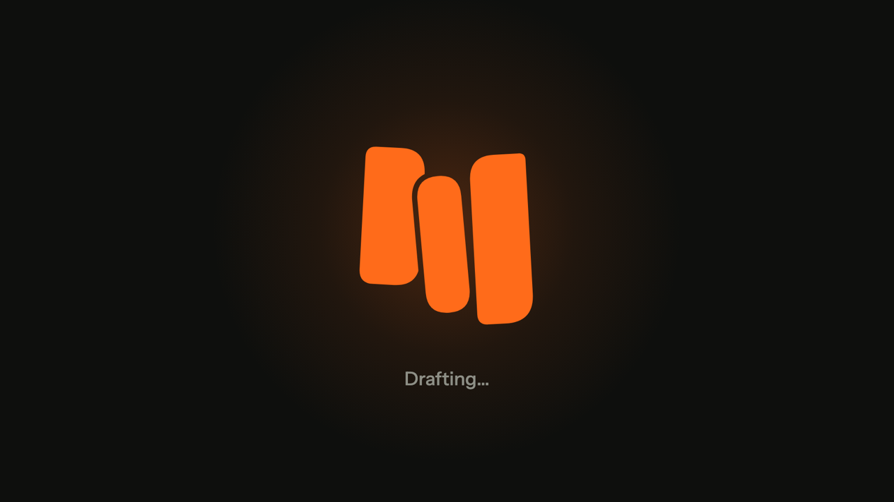
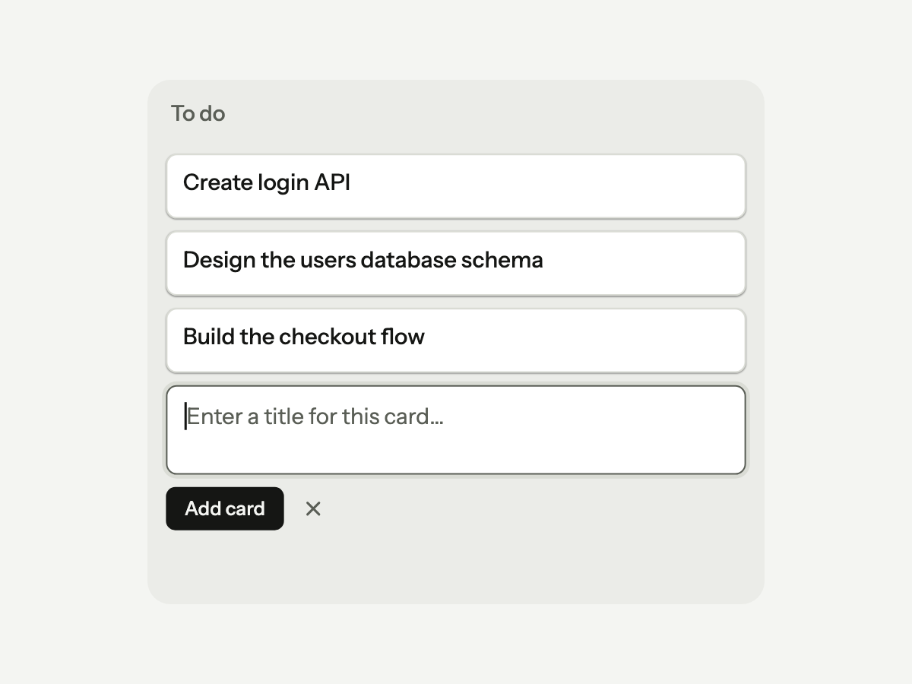
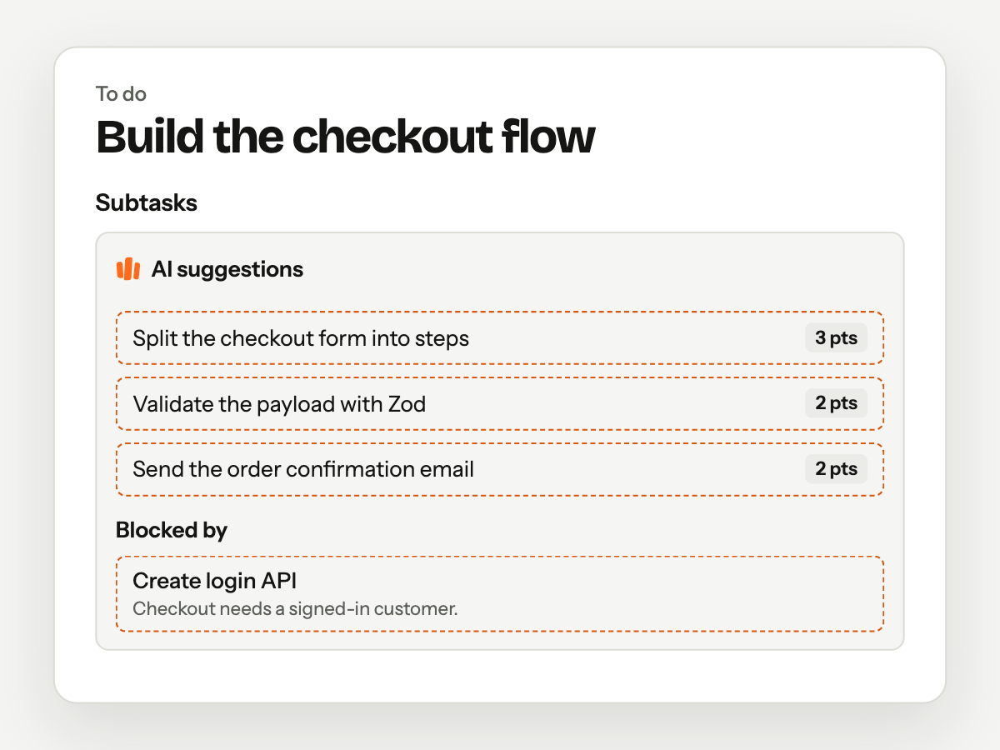
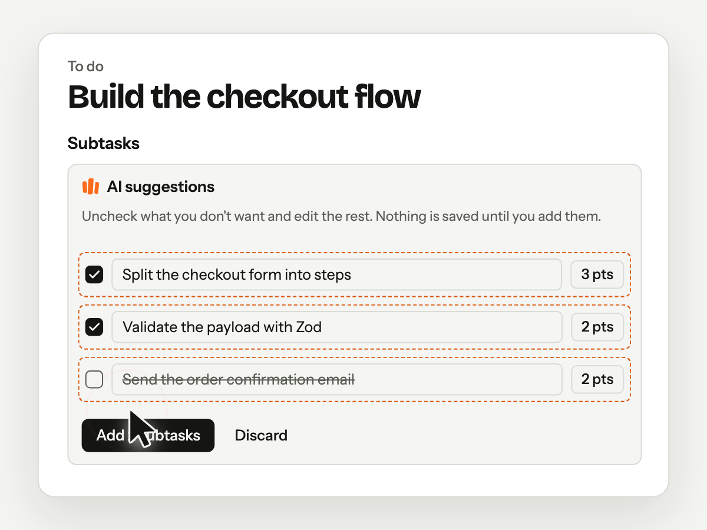
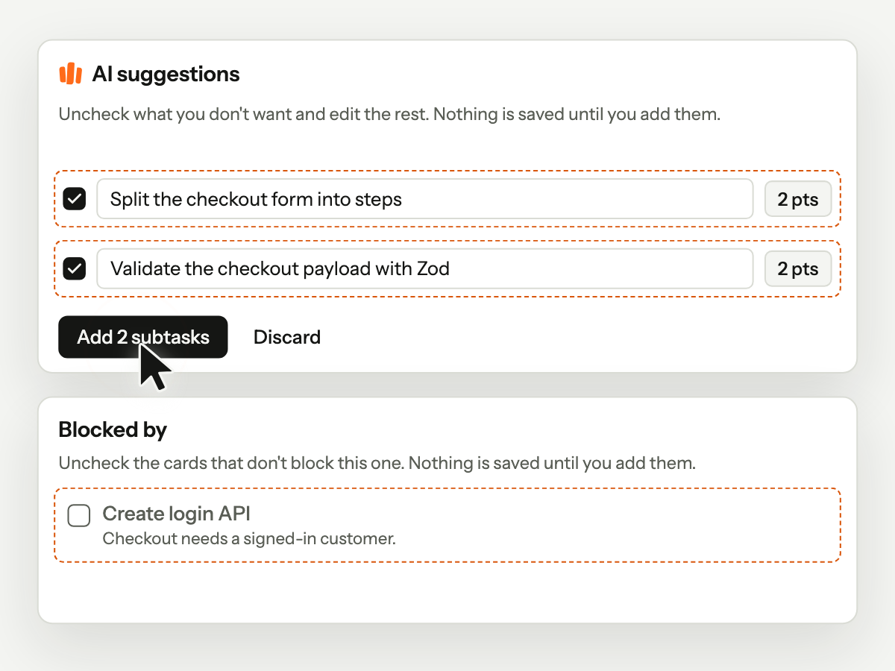

<div align="center">


# ackboard

### AI proposes. You ack.

A kanban board where AI drafts the subtasks, estimates and dependencies,<br />
and nothing touches your board until a person signs off on it.

[](https://kanban.utitytools.com)
[](https://www.youtube.com/watch?v=-wruYYEdhg4)
[](https://github.com/utity-tools/ai-driven-kanban/actions/workflows/ci.yml)
[](LICENSE)

**[Try the demo](https://kanban.utitytools.com)** (one click, no sign-up) ·
**[Watch the video](https://www.youtube.com/watch?v=-wruYYEdhg4)** ·
**[Read the decisions](docs/adr)**

<br />

<a href="https://www.youtube.com/watch?v=-wruYYEdhg4" title="Watch the 28-second demo on YouTube">
  
</a>

<sub>▶ From a card to an acked plan in 28 seconds. Click to watch on YouTube.</sub>

</div>

---

## Why ackboard

AI that writes straight to your board is a liability. Auto-generated tasks look productive until
someone has to clean them up.

ackboard keeps the AI in **draft mode**. It suggests and you decide, so your board only holds
work a person signed off on. _Ack_ is engineer shorthand for "seen it, approved", and that's the
whole product: **nothing the AI suggests is saved until you ack it.**

## How it works

<table>
  <tr>
    <td width="33%" valign="top">
      <picture>
        <source media="(prefers-color-scheme: dark)" srcset="public/landing/how-it-works-1-write-dark.png" />
        
      </picture>
      <p><b>1. Write the card</b><br />Describe the work the way you'd brief a teammate.</p>
    </td>
    <td width="33%" valign="top">
      <picture>
        <source media="(prefers-color-scheme: dark)" srcset="public/landing/how-it-works-2-draft-dark.png" />
        
      </picture>
      <p><b>2. Get a draft</b><br />Subtasks, estimates and blocked-by links, streamed in seconds.</p>
    </td>
    <td width="33%" valign="top">
      <picture>
        <source media="(prefers-color-scheme: dark)" srcset="public/landing/how-it-works-3-ack-dark.png" />
        
      </picture>
      <p><b>3. Ack what's right</b><br />Accept, edit or discard each item. Only what you ack is saved.</p>
    </td>
  </tr>
</table>

## The review is the product

<table>
  <tr>
    <td width="50%" valign="middle">
      <picture>
        <source media="(prefers-color-scheme: dark)" srcset="public/landing/review-spotlight-dark.png" />
        
      </picture>
    </td>
    <td width="50%" valign="middle">
      Every proposal arrives as a draft you can edit inline: change an estimate, rename a
      subtask or drop a dependency, then ack.
      <br /><br />
      ackboard never proposes a link that would create a cycle, and every AI response is
      validated against a schema before you see it.
    </td>
  </tr>
</table>

## Everything on the board

|                                         |                                                                                 |
| --------------------------------------- | ------------------------------------------------------------------------------- |
| 🔗 **Dependencies that mean something** | Blocked-by links, cycle checks, blocked badges and a bottlenecks panel.         |
| 👥 **Built for the whole team**         | Live sync and presence for everyone on the board; invite with single-use links. |
| 📝 **Cards with depth**                 | Markdown, labels, due dates, members and subtask checklists.                    |
| ✋ **Move fast**                        | Reorder cards and columns with mouse, touch or keyboard.                        |
| 🔒 **Private by default**               | Owner, editor and viewer roles, enforced by Row Level Security in Postgres.     |
| 🧪 **Try it in one click**              | Demo boards with no sign-up, deleted automatically after 7 days.                |

## Engineering highlights

Designed, built and shipped end to end by one person, in production at
[kanban.utitytools.com](https://kanban.utitytools.com).

- **AI you can trust:** versioned prompts, streaming structured output validated with Zod, user
  text delimited as untrusted input, an [eval suite](evals) for quality, and per-call
  [observability](docs/observability.md) (cost, latency, tokens, outcome).
- **Security in depth:** Row Level Security on every table, tested with pgTAP; column-level
  grants; a nonce-based Content Security Policy; and AI calls routed only to providers that don't
  train on your data ([ADR 0025](docs/adr/0025-disallow-prompt-training.md)).
- **Deterministic where it matters:** cycle detection, blocked tasks and bottlenecks live in pure,
  unit-tested TypeScript, not in the model.
- **Cost under control:** daily quotas per account and per demo session, plus a global budget cap
  ([ADR 0016](docs/adr/0016-daily-ai-quotas-and-cost-cap.md),
  [ADR 0024](docs/adr/0024-launch-ai-cost-limits.md)).
- **Tested on every PR:** unit tests (Vitest), end-to-end tests (Playwright) and database tests
  (pgTAP). Production deploys only after migrations succeed.
- **Every decision written down:** 25 [architecture decision records](docs/adr) and blameless
  [incident post-mortems](docs/incidents).

## Stack

| Area    | Tools                                                                                  |
| ------- | -------------------------------------------------------------------------------------- |
| App     | Next.js 16 (App Router, Server Actions, React Compiler) · React 19 · TypeScript strict |
| UI      | Tailwind CSS v4 · shadcn/ui · dnd-kit                                                  |
| Data    | Supabase: Postgres, Auth, Row Level Security, Realtime                                 |
| AI      | Vercel AI SDK v6 · AI Gateway · Zod-validated structured output                        |
| Quality | Vitest · Playwright · pgTAP · ESLint · Prettier · Husky · commitlint · GitHub Actions  |

## AI: privacy and limits

- **What is sent:** when you click **Suggest with AI** (subtasks), the card's title, description
  and existing subtask titles; when you click **Suggest blockers with AI**, the card's title,
  description and column, plus the titles, columns and done state of up to 100 other cards on
  the board. Nothing else. It goes through [Vercel AI Gateway](https://vercel.com/ai-gateway) to
  the model provider (Anthropic, Claude Haiku 4.5 by default). Don't put secrets or personal
  data in cards on a board where you use the AI.
- **No training:** every call asks the Gateway to route only to providers that don't train on
  the data you send; if none is available, the call fails instead
  ([ADR 0025](docs/adr/0025-disallow-prompt-training.md)).
- **What is stored:** nothing from the model until you accept it. Accepted subtasks and blockers
  are saved like any others. For quotas and monitoring, the app records metadata about each call
  (who, when, which feature, model, tokens, cost, duration and how it ended), never the card
  text or the response ([observability](docs/observability.md)).
- **Limits:** 20 suggestions a day per account and 3 per demo session (subtasks and blockers
  combined), plus a global daily budget. All reset at midnight UTC
  ([ADR 0016](docs/adr/0016-daily-ai-quotas-and-cost-cap.md),
  [ADR 0024](docs/adr/0024-launch-ai-cost-limits.md)).

## Roadmap

- [x] **v0.1** Board, auth, RLS, drag and drop, demo mode, deploy
- [x] **v0.2** AI task decomposition with streaming, human review and daily quotas
- [x] **v0.3** Card dependencies (cycle checks, blocked badges, bottlenecks), invites, Realtime
      and AI-proposed blockers
- [x] **v0.4** AI evals and observability (cost, latency, tokens, outcomes)
- [x] **Launch** Custom domain, email confirmation and password reset, AI live in production
- [x] **Brand** The ackboard identity, a landing page with product loops, and a promo video

## Getting started

Requirements: Node 24, pnpm, Docker (e.g. [OrbStack](https://orbstack.dev)).

```bash
pnpm install
pnpm db:start     # local Supabase in Docker
pnpm env:local    # writes local Supabase values into .env.local
pnpm dev          # http://localhost:3000
```

Full guide, commands, environments and known issues: [docs/setup.md](docs/setup.md).

## Documentation

| Doc                                    | What it covers                                                             |
| -------------------------------------- | -------------------------------------------------------------------------- |
| [Setup](docs/setup.md)                 | First run, commands, environments, where each variable lives, known issues |
| [Workflow](docs/workflow.md)           | Branch → PR → preview → merge, agents, enforcement layers, dependencies    |
| [Security](docs/security.md)           | Secrets inventory, rules, safeguards, leak procedure, incidents            |
| [Observability](docs/observability.md) | AI call events, usage records and ready-made SQL                           |
| [ADRs](docs/adr)                       | Architecture decisions and why they were made                              |

## How this project is built

Development is AI-assisted, with guardrails:

- **Context for agents:** [`AGENTS.md`](AGENTS.md) holds the stack, commands and conventions;
  [`CLAUDE.md`](CLAUDE.md) adds Claude Code specifics.
- **Specialised subagents** in [`.claude/agents`](.claude/agents): DB architect, frontend, AI,
  QA and a read-only code reviewer.
- **Enforced workflow:** feature branches, Conventional Commits, PRs squash-merged into `main`
  with CI green. Enforced by Claude Code hooks, git hooks and branch rules, not just by convention.
- **Decisions** are recorded as ADRs in [`docs/adr`](docs/adr), incidents as blameless
  post-mortems in [`docs/incidents`](docs/incidents).

## License

[MIT](LICENSE) · Built by utity tools (Héctor Arrieta)
